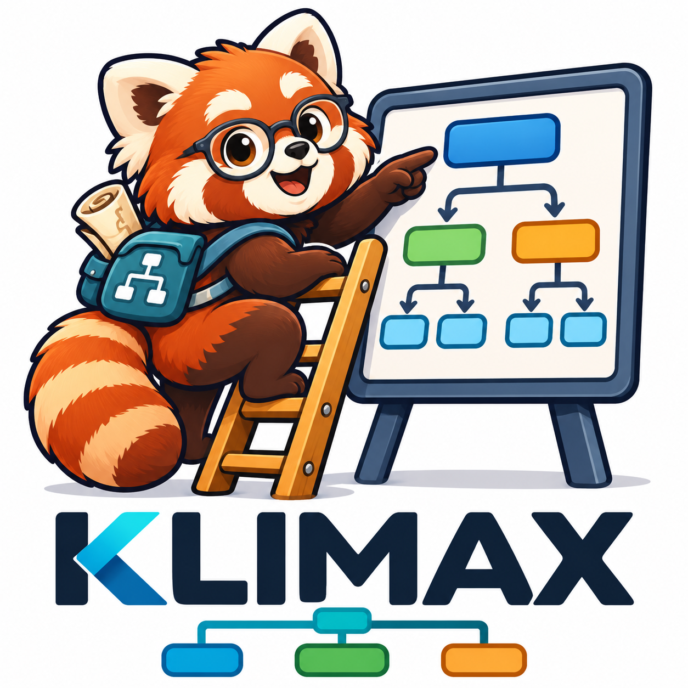

<p align="center">
  
</p>

<h1 align="center">Klimax (κλῖμαξ)</h1>

<p align="center">
  <b>An HTN planner for HDDL in C++20, usable as a library, as an executable, from Python and
  from the Unified Planning Framework.</b>
</p>

<p align="center">
  <a href="https://github.com/PlanSys2/klimax/actions/workflows/ci.yml"></a>
  <a href="LICENSE"></a>
  
  
  
  
  
  <a href="https://github.com/PlanSys2/up-klimax"></a>
  
</p>

Klimax (Greek for *ladder*) plans with hierarchies of tasks. It reads
[HDDL](https://doi.org/10.1609/aaai.v34i06.6542), the language of the hierarchical tracks of the
International Planning Competition (IPC), and gives back the sequence of actions together with
its decomposition: which method was applied to each task and what each of its subtasks became.
It is developed within the [PlanSys2](https://github.com/PlanSys2) organization, next to
[Kairos](https://github.com/PlanSys2/kairos), whose modules it is built on (parser, grounder,
Datalog engine, the evaluator and the validator of plans). It does not depend on ROS.

> **Status**: in development, no release yet. Klimax plans HDDL 1.0 problems (total and partial
> order) and those with the numeric fluents of HDDL 2.1. Of time, the other extension of
> HDDL 2.1, it plans with durative actions one after another; the rest is the current phase of
> the [roadmap](docs/roadmap.md).

**How it compares**: on the benchmark of the HTN tracks of IPC 2023, with every plan checked by
the IPC verifier and the same limits for all, Klimax solves 626 of the 761 total-order problems
in 30 s (the best of the other thirteen configurations measured, 494) and 251 of the 283
partial-order ones (the best of the other seven, 207). Results by domain, where it is behind and
the method in [docs/results.md](docs/results.md) and [docs/baseline.md](docs/baseline.md).

## What it does

- **Plans** totally and partially ordered problems, with method preconditions, constraints
  between variables, the conditions and effects of ADL, numeric fluents, action costs and
  fluents whose value is an object.
- **Proves** when a problem has no plan, instead of running out of time.
- **Anytime**: after the first plan it goes on to better ones and, when none is left, says that
  the plan is the best: the cheapest by the metric of the problem when it adds up action costs,
  the shortest when there is no metric.
- **Verifies** hierarchical plans in the format of the IPC, independently of the planner, and
  its own before returning them: a plan the verifier rejects is reported as an internal error,
  never given.
- **Checks** a domain and a problem and reports every error with file, line and column.
- **Library first**: no global state, a time limit on every call, plans returned as data.

## Using it

### Executable

```
klimax DOMAIN PROBLEM [--timeout S]           # the plan and its decomposition, in the IPC format
klimax DOMAIN PROBLEM --timeout S --anytime   # go on to better plans; says if none is better
klimax DOMAIN PROBLEM --no-verify             # skip the check of the plan before writing it
klimax --check DOMAIN PROBLEM                 # read the input and report every error
klimax --verify DOMAIN PROBLEM PLAN           # check a plan in the format of the IPC HTN tracks
```

Exit codes: 0 solved, 10 unsolvable (proved), 11 out of time, 12 not supported, 1 errors in the
input.

### C++

```cpp
#include <klimax/klimax.hpp>

klimax::SolveOptions options;
options.seconds = 30;
klimax::SolveResult result = klimax::solve(domain_text, problem_text, options);
if (result.status == klimax::Status::Solved) {
  std::cout << result.plan;  // actions and decomposition, IPC format
}
```

```cmake
find_package(klimax REQUIRED)
target_link_libraries(my_target PRIVATE klimax::klimax)
```

### Python

```python
import klimax

result = klimax.solve(domain_text, problem_text, timeout=30)
if result.status == klimax.Status.SOLVED:
    for step in result.steps_of_plan:  # each action; each task with its method and subtasks
        print(step.id, step.task, step.args, step.method, step.subtasks)
```

More in [python/README.md](python/README.md).

### Unified Planning Framework

[up-klimax](https://github.com/PlanSys2/up-klimax) makes Klimax an engine of the
[Unified Planning Framework](https://github.com/aiplan4eu/unified-planning): a oneshot and
anytime planner for hierarchical problems, a validator of hierarchical plans and a compiler.

## Building

Klimax needs Kairos installed with its internal modules (`kairos::core`):

```bash
git clone https://github.com/PlanSys2/kairos.git
git clone https://github.com/PlanSys2/klimax.git

cmake -S kairos -B build-kairos -DKAIROS_INSTALL_CORE=ON -DCMAKE_INSTALL_PREFIX=$PWD/prefix
cmake --build build-kairos -j && cmake --install build-kairos

cmake -S klimax -B build-klimax -DCMAKE_PREFIX_PATH=$PWD/prefix
cmake --build build-klimax -j
ctest --test-dir build-klimax --output-on-failure
./build-klimax/src/cli/klimax --version
```

Add `-DKLIMAX_BUILD_PYTHON=ON` for the Python module (needs
[nanobind](https://github.com/wjakob/nanobind)). In a colcon workspace:
`colcon build --cmake-args -DKAIROS_INSTALL_CORE=ON`.

## Documents

- [docs/semantics.md](docs/semantics.md): the language Klimax accepts and what a solution is.
- [docs/results.md](docs/results.md): Klimax against the other planners, on total and partial
  order.
- [docs/baseline.md](docs/baseline.md): the existing HTN planners on the IPC 2023 benchmark, and
  how they were measured.
- [docs/roadmap.md](docs/roadmap.md): what is done and what comes next.

## License

Apache-2.0.
